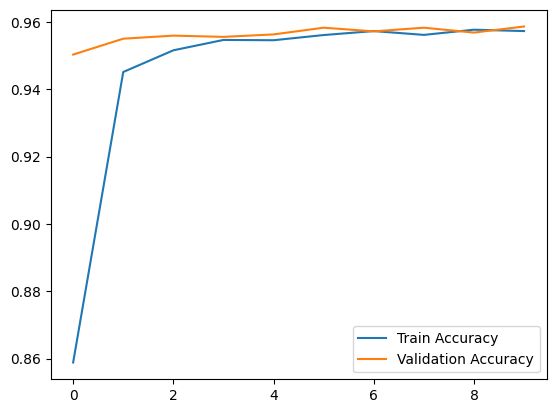
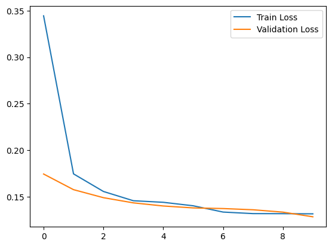
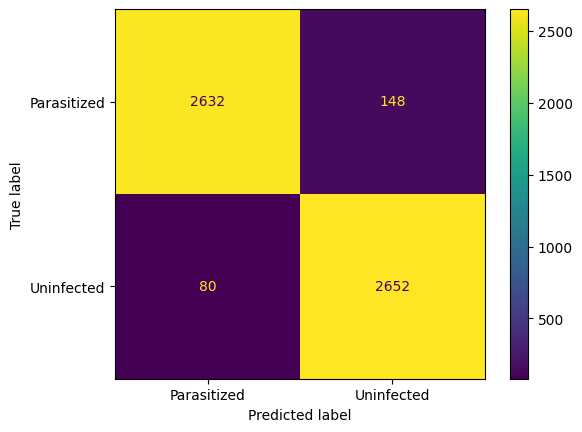
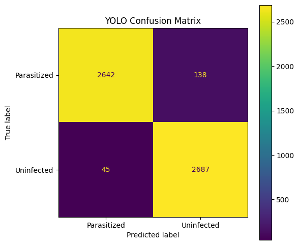
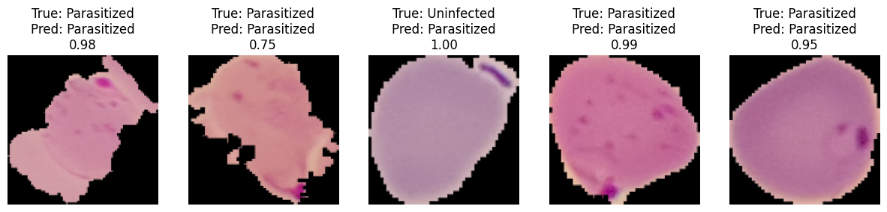
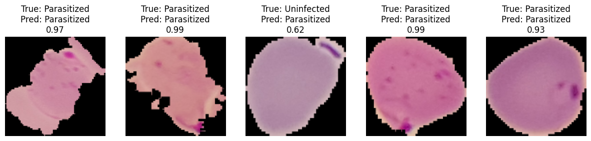
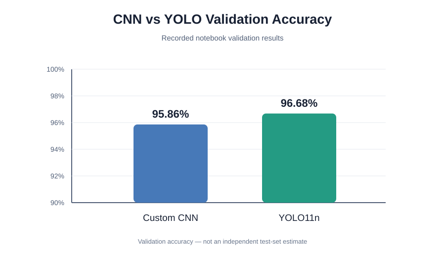

# Malaria Cell Classification Using CNN and YOLO

A deep learning project that classifies microscopic malaria cell images into two categories:

- **Parasitized**
- **Uninfected**

The project implements and compares a custom Convolutional Neural Network (CNN) built from scratch with a pretrained YOLO11n classification model fine-tuned on the malaria dataset.

## Project Overview

The project explores two image-classification approaches:

1. **Custom CNN:** built with TensorFlow and Keras.
2. **YOLO11n Classification:** initialized from pretrained weights and trained on the malaria dataset using Ultralytics.

The comparison focuses on validation accuracy and the models' classification behavior.

## Dataset

- **Source:** Malaria dataset provided by TensorFlow Datasets (TFDS).
- **Total images:** 27,558.
- **Classes:** Parasitized and Uninfected.
- **Image size used by the models:** 128 × 128 pixels.
- **Split:** 80% training (22,046 images) and 20% validation (5,512 images).

The same 80/20 split is used to train and validate both models.

> **Evaluation note:** The notebook uses the validation split during training and reports the final metrics on that same split. It does not currently contain a separate, untouched test set. Therefore, the reported results are validation results, not an independent test estimate.

## Model 1: Custom CNN

The CNN was designed and trained from scratch using TensorFlow/Keras.

### Architecture

```text
Input (128 × 128 × 3)
        ↓
Data Augmentation
        ↓
Conv2D (32) → MaxPooling
        ↓
Conv2D (64) → MaxPooling
        ↓
Conv2D (128) → MaxPooling
        ↓
Flatten
        ↓
Dense (128) → Dropout (0.5)
        ↓
Softmax (2 classes)
```

### Training configuration

- Optimizer: Adam
- Loss: Sparse Categorical Crossentropy
- Batch size: 32
- Epochs: 10
- Data augmentation: random horizontal flip, rotation, and zoom

## Model 2: YOLO Classification

The project uses the pretrained `yolo11n-cls.pt` classification model from Ultralytics.

The TFDS images are exported into the directory structure required by Ultralytics, with separate training and validation folders for each class.

### Training configuration

- Model: YOLO11n-cls
- Image size: 128 × 128
- Batch size: 32
- Epochs: 10
- Dataset split: 22,046 training images and 5,512 validation images

## Results

The following values are taken from the recorded notebook outputs.

| Model | Validation Accuracy |
|---|---:|
| Custom CNN | 95.86% |
| YOLO11n Classification | 96.68% |

YOLO's recorded Top-5 validation accuracy is 100%. Because this is a two-class classification task, Top-1 accuracy is the more informative metric to compare.

### YOLO validation classification report

| Class | Precision | Recall | F1-score |
|---|---:|---:|---:|
| Parasitized | 0.97 | 0.95 | 0.96 |
| Uninfected | 0.95 | 0.97 | 0.96 |
| **Weighted average** | **0.96** | **0.96** | **0.96** |

These class-level metrics are from the YOLO validation classification report recorded in the notebook.


## Visual Results

The following figures are taken from the saved notebook outputs.

### CNN Training Curves





### Confusion Matrices





### Sample Predictions





### Model Comparison



## Features

- Custom CNN architecture built from scratch
- Pretrained YOLO11n classification model
- TFDS dataset loading and preprocessing
- Image resizing and normalization
- Data augmentation for CNN training
- Training and validation accuracy/loss curves
- Confusion matrices
- Sample predictions with confidence scores
- CNN and YOLO validation-accuracy comparison

## Technologies Used

- Python
- TensorFlow
- Keras
- TensorFlow Datasets
- Ultralytics YOLO
- OpenCV
- NumPy
- Matplotlib
- Scikit-learn

## How to Run

The project is provided as a Jupyter Notebook.

1. Open **[CNN and YOLO.ipynb](./CNN%20and%20YOLO.ipynb)** in Google Colab or a Jupyter environment.
2. Install the required packages if they are not already available:

   ```bash
   pip install -r requirements.txt
   ```

3. Run the notebook cells in order. The notebook downloads the malaria dataset through TensorFlow Datasets and prepares the directory structure needed for YOLO training.

YOLO training can require a GPU and sufficient storage because the dataset images are exported to disk.

## Conclusion

Both models achieved validation accuracy above 95% on the recorded validation split. The custom CNN achieved **95.86%**, while YOLO11n Classification achieved **96.68%**.

YOLO achieved a 0.82 percentage-point higher validation accuracy in this experiment. This comparison is limited to the current validation setup; a separate test set is needed to assess performance on unseen data more reliably.

## Author

**Mostafa Abdelwahab**

- GitHub: [Mo22afa](https://github.com/Mo22afa)
- Repository: [Malaria Classification Using CNN and YOLO](https://github.com/Mo22afa/Malaria-Classification-CNN-YOLO)

---

*This project is for educational and research purposes. It is not a medical diagnostic tool.*
